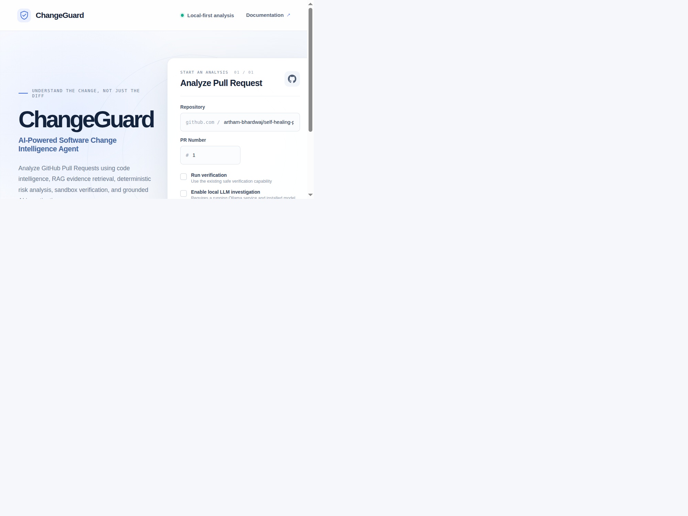
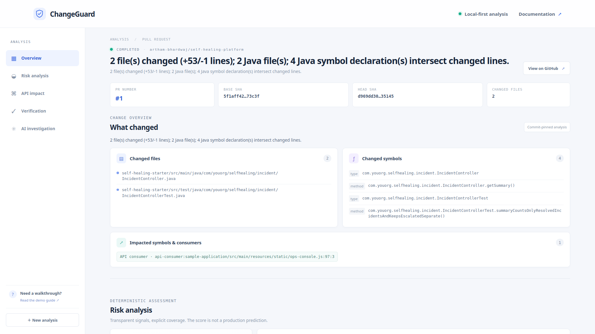
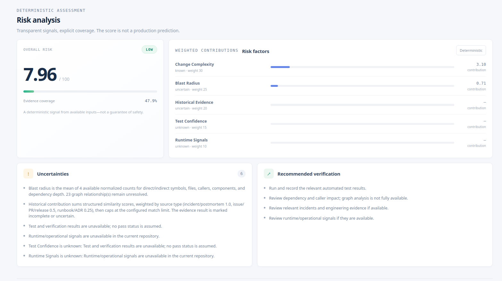
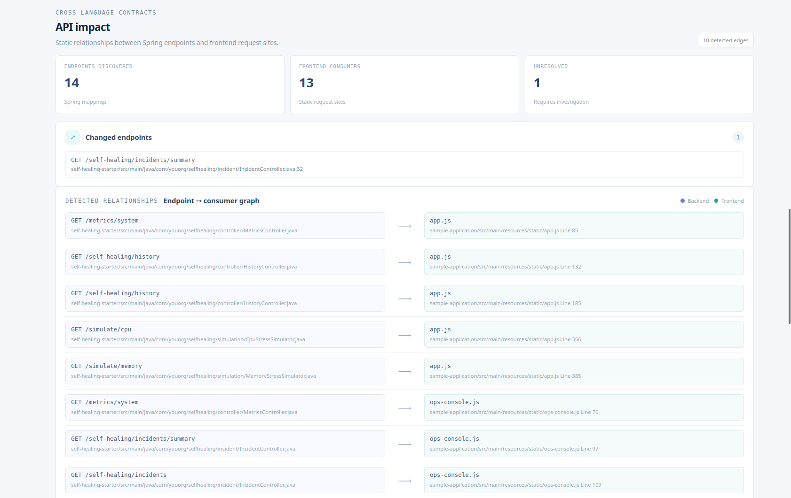
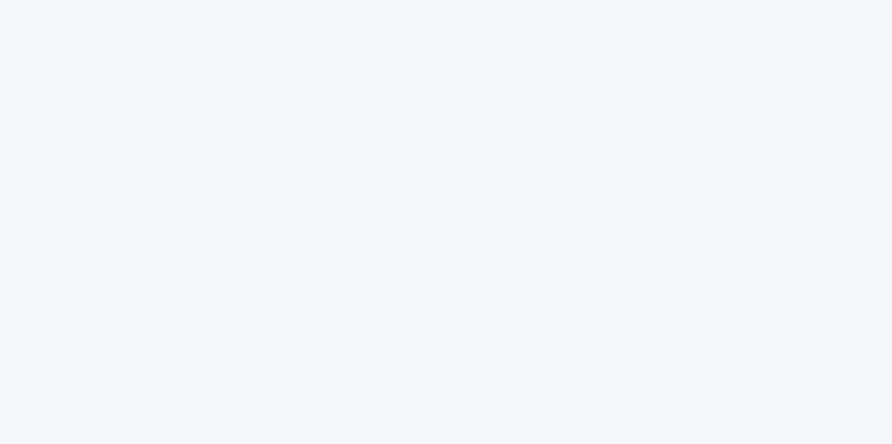

# ChangeGuard

ChangeGuard is an AI software engineering agent that analyzes GitHub pull requests using deterministic code intelligence, MCP tool calling, RAG-based engineering evidence retrieval, sandbox verification, and grounded LLM investigation.

## Problem

Large codebases make it difficult to understand the real impact of a pull request. A diff shows what changed, but not which methods, APIs, frontend consumers, historical signals, or verification gaps matter before merge.

## Solution

ChangeGuard builds an evidence-backed understanding of software changes. It uses immutable revision analysis, code intelligence, cross-language API mapping, local evidence retrieval, deterministic risk scoring, and a bounded AI investigation to explain what changed and what may be affected.

## Architecture

```text
Developer PR
    ↓
GitHub Integration
    ↓
Code Intelligence
    ↓
API Impact Graph
    ↓
RAG Evidence
    ↓
Risk Engine
    ↓
Verification Sandbox
    ↓
AI Agent
    ↓
Grounded Report
```

## Features

- GitHub PR analysis
- Java code intelligence
- Cross-language API impact
- RAG evidence retrieval
- MCP tool-based AI agent
- deterministic risk engine
- sandbox verification
- evaluation framework

## Demo

The local demo is a lightweight, browser-based presentation layer around the existing ChangeGuard analysis flow. It can load a real PR result or a realistic saved sample without requiring GitHub credentials.

<p align="center">
  
</p>

<p align="center">
  
</p>

<p align="center">
  
</p>

<p align="center">
  
</p>

<p align="center">
  
</p>

## Quick start

Python 3.12 or later is required.

```sh
python -m venv .venv
. .venv/bin/activate
python -m pip install -e ".[dev]"   # or: python -m pip install -r requirements.txt
```

To use the `changeguard` command from any directory, put settings in the user-wide file
`~/.config/changeguard/.env` (see [`.env.example`](.env.example)):

```sh
mkdir -p ~/.config/changeguard
cp .env.example ~/.config/changeguard/.env   # then fill in GEMINI_API_KEY etc.
```

ChangeGuard loads settings from, in order of priority: real environment variables,
`CHANGEGUARD_ENV_FILE` or the nearest `.env` in the current directory or its parents
(up to the git root), then `~/.config/changeguard/.env`.

GitHub access uses `GITHUB_TOKEN`/`GH_TOKEN` if set, otherwise the token of a logged-in
[GitHub CLI](https://cli.github.com) (`gh auth login`). Public repositories work without a token.
Set `CHANGEGUARD_USE_GH_TOKEN=0` to disable the `gh` fallback.

## Usage

### Review a pull request

```sh
changeguard pr analyze OWNER/REPO#123
changeguard pr analyze https://github.com/OWNER/REPO/pull/123 --llm   # add an AI investigation
changeguard pr analyze OWNER/REPO#123 -o review.md                   # also save the report
changeguard pr analyze OWNER/REPO#123 --json                         # full structured result
```

The report covers the risk score and its factors, changed files and methods, changed API
endpoints with the frontend code that calls them, related past incidents, the AI findings,
recommended checks, and the analysis limitations.

### Analyze local commits

```sh
cd path/to/repo
changeguard impact                              # HEAD~1..HEAD
changeguard impact --base main --head my-branch
changeguard impact --repo ../other --base v1.2 --head v1.3 --llm
```

### Add historical evidence

Past incidents, postmortems, runbooks and architecture decisions make the risk score and
AI investigation more useful. Evidence is matched to the repository it belongs to
(`OWNER/REPO` for GitHub clones).

```sh
changeguard evidence add incidents/*.md --type incident --repo OWNER/REPO
changeguard evidence add docs/adr/*.md --type architecture_decision   # repo inferred from cwd
changeguard evidence list
changeguard evidence search "payment retry timeout"
```

Types: `incident`, `postmortem`, `runbook`, `architecture_decision`, `issue`, `pull_request`, `release_note`.

Analyses and evidence are stored in `~/.local/share/changeguard/changeguard.sqlite3`
(override with `CHANGEGUARD_DATABASE` or `--database`).

### Browser demo

```sh
changeguard demo     # http://127.0.0.1:8000
```

### AI investigation (optional)

Deterministic analysis is the default and makes no LLM calls. Add `--llm` (or tick the LLM
option in the demo) for a bounded AI investigation. Choose the provider with
`--llm-provider ollama|gemini` or `CHANGEGUARD_LLM_PROVIDER`; the demo always uses the setting.

- **Gemini:** set `GEMINI_API_KEY` and `CHANGEGUARD_LLM_PROVIDER=gemini`.
- **Ollama:** runs locally. Install [Ollama](https://ollama.com) and pull the model, e.g. `ollama pull qwen2.5:1.5b`.

The Gemini provider only receives bounded investigation prompts and read-only MCP results. It is
limited to one MCP tool call, 12,000 prompt characters, 800 output tokens (thinking set to `low`
so it does not consume the budget), and a three-request budget per analysis; temporary API errors
(429/5xx) are retried twice without using that budget. If Gemini fails, ChangeGuard keeps the
deterministic analysis and notes the failure in the report. The key is never persisted, logged,
or committed.

### Sandboxed verification (optional)

`--verify` runs planned checks for changed **Python** code (matching pytest files and `py_compile`)
inside a Linux [bubblewrap](https://github.com/containers/bubblewrap) sandbox, and reports
`BLOCKED` if `bwrap` is missing (`sudo apt install bubblewrap` on Debian/Ubuntu). Java/Maven
projects are not verified.

### Development

```sh
python -m pytest
changeguard evaluate --all
```

## Example Output

```text
PR: artham-bhardwaj/self-healing-platform#1
Changed files: 2
Changed symbols: 2 methods
API impact: 14 endpoints · 13 consumers · 10 deterministic edges
Risk: LOW · 7.96 / 100 (47.86% weight coverage)
Verification: BLOCKED · Java/Maven unsupported by the configured verifier
LLM: sample report only; no live model output was recorded for the saved PR
```

## Limitations

- Java and API resolution are intentionally conservative and may leave some relationships unresolved.
- Verification is opt-in and limited to the existing supported checks.
- Grounded AI investigation depends on the local environment and the available evidence.
- The demo is intended for loopback-only local use and does not add authentication, cloud hosting, or persistent storage.
